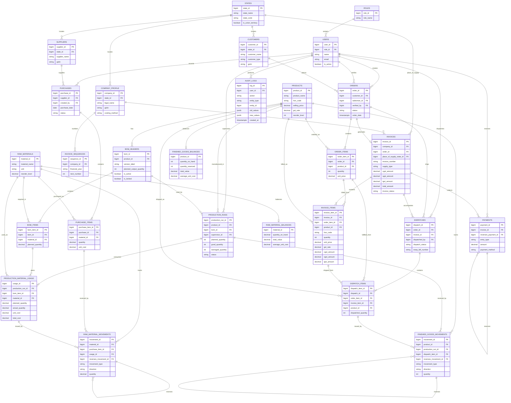

# Entity Relationship Diagram

This diagram matches the entities and relationships in `docs/database-schema.md`.
That schema file is the source of truth for columns, checks, indexes, and posting rules.

Calculated results are not entities. Yield, material variance, cost per good packet, and invoice outstanding amount are derived when they are read.

PostgreSQL tables have not been created.

## Relationship notes

- One company row is allowed. Its state is the factory state used for GST.
- One customer order has one invoice and can have many dispatches.
- Each invoice line and each dispatch line points at the order line it fulfills.
- A dispatch points at both an order and an invoice, and those two must be the same order.
- One product has many BOM versions and only one active version. A production run points at the product and at the BOM version it used.
- Raw-material stock and finished-goods stock have separate balances and separate movement ledgers.
- A purchase line, a material-usage line, a production run, and a dispatch line are the document links on stock movements.
- A payment reversal points at the receipt it reverses. A stock reversal points at the movement it reverses.
- Damaged production output is stored on the production run. It does not create a finished-goods movement.
